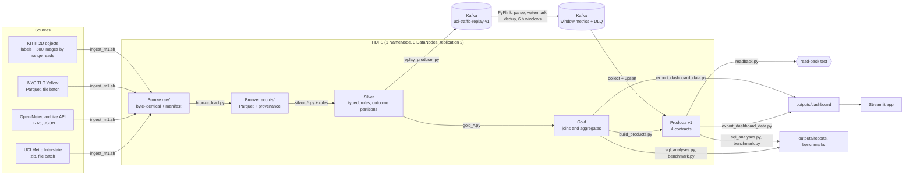

# Architecture and design (D02)

Reference architecture from the course: `docs/spec/assets/BD-FP-Architecture-v1.0.en.png`. This page
describes what was built, the data flow, each component's responsibility and the main design choices.

## Data flow

## Components and responsibilities

| Component | Where | Responsibility |
|---|---|---|
| Ingestion | `src/ingestion/`, `scripts/ingest_m1.sh` | Fetch (file batch, API, HTTP range reads), checksum, skip unchanged, land byte-identical in HDFS Bronze raw, profile and write Bronze Parquet with provenance |
| Storage | HDFS 3.3.6 in `compose.yaml`, `configs/hadoop/` | Bronze / Silver / Gold / products layers, replication 2; catalogue and access rules in `docs/storage_layout.md` |
| Batch | `src/batch/`, Spark 3.5 standalone | Silver: typing, time zones, units, duplicates, rules. Gold: UCI×ERA5 join, NYC zone-hour aggregation |
| Quality | `src/quality/` | Rule model (pure Python), Spark evaluation, accepted / quarantine / rejected, reports; `docs/quality.md` |
| Streaming | `src/streaming/`, Kafka 3.7 (KRaft), Flink 1.18 | Historical event replay, event-time windows with watermark, lateness, dedup, DLQ, checkpoint recovery; `docs/streaming.md` |
| Products | `src/products/`, `contracts/` | Build from contracts, independent read-back test, generated release blocks; `docs/data_products.md` |
| Analytics | `src/analytics/` | SQL analyses and the storage/query benchmark; `docs/analytics.md`, `docs/performance.md` |
| Visualisation | `src/visualisation/` | Export small tables from products; Streamlit dashboard reading only recorded outputs |
| Orchestration | `scripts/run_*.sh`, `scripts/run_all.sh` | One script per milestone; each step PASSes only if its result check passes; evidence per run |

## Design decisions (with the reason)
- **HDFS with 3 DataNodes and replication 2** on one host: spec §3.3 asks for a real distributed store,
  not single-node object storage; it shows block placement and replication (`hdfs fsck`) within a
  16 GB Codespace. Limitation: one failure domain.
- **Bronze keeps raw and records apart** (`raw/` vs `records/`): raw files stay byte-identical for
  re-verification; Spark partition discovery on `records/` sees only `ingest_date=` partitions.
- **Silver never drops records**: every record gets an outcome and its broken rules; reconciliation
  `sum(source_rows) = Bronze rows` is checked in every run.
- **Rule logic in pure Python** (`src/quality/*_rules.py`), evaluated in Spark: unit-testable without
  Spark and readable as a catalogue in the quality report.
- **NYC is never joined to UCI** (different city, no defensible key, spec §4); UCI is joined to ERA5
  only on the UTC hour, with variables aligned by their valid time and the station inside the grid cell.
- **Streaming in the PyFlink DataStream API**, not SQL: malformed messages, de-duplication, late updates
  and side outputs need explicit control. Single watermark generator and Python bundle size 1 are
  correctness choices found by failed runs (see `docs/streaming.md`).
- **At-least-once delivery + upsert by window key** instead of claiming exactly-once; verified by a
  TaskManager kill with an oracle comparison.
- **Contracts drive the product schema**: the builder selects and casts the contract's fields, and a
  separate read-back job checks the written data; release metadata is generated, never typed.
- **Every number from a recorded run**: each script writes `evidence/ACxx/<run>/`; docs cite run ids.
