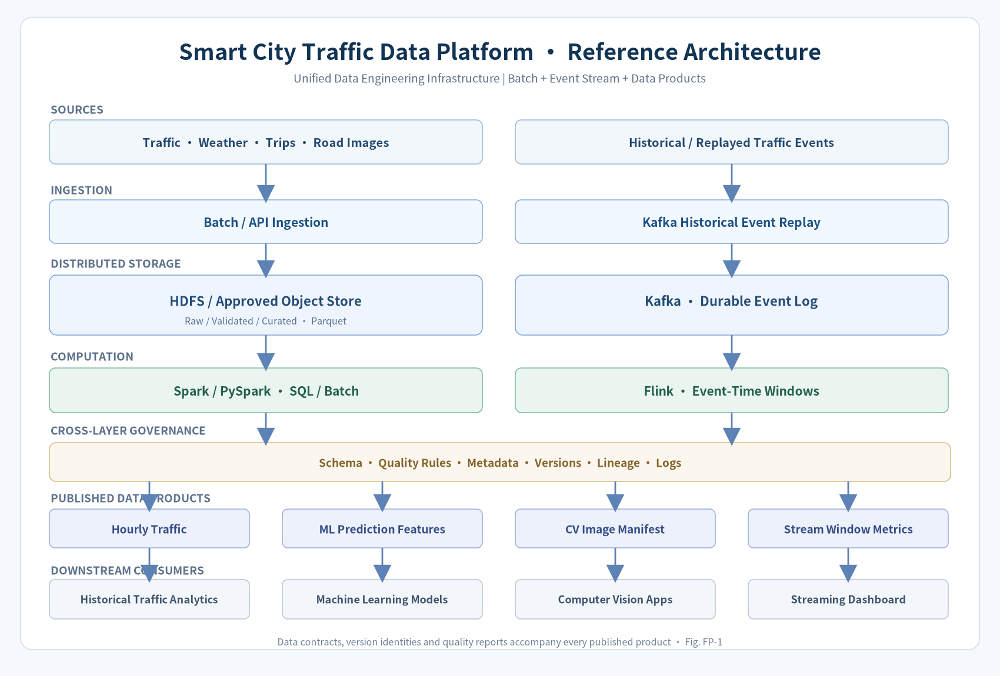

# Big Data Technologies and Applications — Final Project Task Specification

> **Project goal:** Build a functional, reproducible, and verifiable distributed traffic data platform. It should ingest heterogeneous real-world data, preserve traceable raw records, run batch and streaming workloads, govern data quality, and publish standardised products that provide dependable foundations for Machine Learning and Computer Vision.

## 1. Project Background

A smart-city traffic management team needs one platform for historical road traffic volume, weather conditions, large-scale trip records, traffic events, and road-scene images. These datasets differ in source, temporal granularity, format, access method, and quality. Because they are fragmented across systems, teams cannot analyse them consistently, compute streaming metrics, or prepare data for downstream AI use.

As a **Data Platform Engineer**, design and implement a platform prototype. It must ingest the selected sources, preserve raw records with traceable provenance, run distributed computations and replayed events, enforce quality checks, and publish versioned data products for analysts and AI developers.

The focus is a **big-data engineering system**, not the development of traffic-prediction models or a full website or business-management application.

## 2. Objectives and Expected Outcomes

By completing this project, students should be able to:

1. Profile and document real data sources, including schemas, semantics, licences, refresh patterns, and temporal/spatial coverage.
2. Implement reliable layered storage in HDFS or an approved object-storage environment and explain the distributed-storage mechanism.
3. Develop repeatable batch transformation and query workloads with Apache Spark / PySpark / Spark SQL.
4. Build event ingestion and event-time window processing with Apache Kafka and Apache Flink.
5. Validate and manage schemas, missing values, outliers, duplicates, timestamps, versions, and metadata.
6. Run comparable performance experiments on formats, partitioning, and query strategies, and interpret the results.
7. Publish versioned data products with contracts, quality reports, and consumption instructions for ML/CV.
8. Deploy, rerun, monitor, and demonstrate the platform using verifiable test evidence.

## 3. Scope and System Architecture



[Download editable vector architecture diagram (SVG)](assets/BD-FP-Architecture-v1.0.en.svg)

### 3.1 Mandatory scope

- **Data-engineering backend:** data ingestion, distributed storage, Spark batch processing, Kafka/Flink stream processing, quality control, data organisation, and publication.
- **Data access:** provide at least one reusable access mechanism, such as Spark SQL tables/views, a controlled file-delivery interface, or a REST API; **a REST API is not mandatory**.
- **Basic visualisation:** show platform data statistics, traffic analytics, quality metrics, batch and stream outputs, and at least one performance comparison. Notebooks, Streamlit, Grafana, or an equivalent solution are acceptable.
- **Deployment and reproducibility:** use a course-provided base environment or a reproducible environment such as Docker Compose to run the core pipelines. Merely installing tools without executing substantive workloads does not meet the requirement.

### 3.2 Out of scope

A standalone React/Vue frontend, user registration/login, a complete authorisation system, complex CRUD interfaces, traffic-prediction model training, vehicle-detector training, and production-grade high availability are **not required**. Existing tools may be used to show logs and metrics.

### 3.3 Technology boundaries

Spark batch processing and Kafka/Flink stream processing are the designated core paths. Storage must be a real HDFS cluster or a course-approved object-store setup whose distributed properties can be verified; **a standalone single-node MinIO instance does not, by itself, demonstrate distributed storage**. Approved substitutions must provide equivalent functions and evidence.

## 4. Data Sources and Requirements

The project must cover at least two independent types of real data sources and manage a set of road-scene images with associated metadata. The following shared source pool is recommended:

| Data source | Recommended use | Constraints |
|---|---|---|
| UCI Metro Interstate Traffic Volume | Hourly road volume, weather-related analysis, ML traffic prediction product | About 48,204 observations; preserve road segment, direction, units, time-zone interpretation and existing weather fields; not a million-row dataset |
| Open-Meteo Historical Weather API | Independent API ingestion, weather semantics and temporal alignment | Join only where location and date are defensible; distinguish reanalysis weather data from direct station observations |
| NYC TLC Trip Record Data | Real large-scale Parquet batch jobs, partitioning and performance comparisons | Treat as a separate urban travel dataset; taxi trip demand is not road-counter traffic volume |
| KITTI Object Detection | CV image directory, label manifest, availability and file-integrity checks | Follow dataset licence and access conditions; do not publicly redistribute images through the project repository |

**Official source links:**

- UCI: https://archive.ics.uci.edu/dataset/492/metro+interstate+traffic+volume
- Open-Meteo: https://open-meteo.com/en/docs/historical-weather-api
- NYC TLC: https://www.nyc.gov/site/tlc/about/tlc-trip-record-data.page
- KITTI: https://www.cvlibs.net/datasets/kitti/eval_object.php

**Data integrity constraints:** Where different cities, periods, or datasets lack defensible spatial keys, publish them as separate products rather than fabricate record-level joins. Label replayed historical data as *historical event replay*, not live sensor readings. Repeated copies of the same underlying records do not qualify as genuine business-data scale.

**Minimum volume:** The project must meet three thresholds:

- Functional test: at least 10,000 records.
- Large-scale batch test: at least 1,000,000 distinct source business records. An appropriate NYC TLC subset is suitable.
- Event replay test: at least 10,000 event-time records.

If licences, upstream availability, or teaching hardware make these thresholds impractical, obtain instructor approval for equivalent data or adjusted acceptance criteria before execution. Document the limitation. Extension testing may use more than 10,000,000 real business records.

## 5. Mandatory Project Tasks

| ID and task | Implementation requirements | Minimum acceptance |
|---|---|---|
| **T01 — Data Source Profiling and Ingestion** | Produce a source inventory with origin, licence, download/API address, fields, temporal/spatial range, and update behaviour. Implement at least two ingestion patterns: one file-based batch path and one independent API or comparably distinct-source path. Preserve raw data, ingestion timestamps, origin, version, and integrity information. | Re-ingest prescribed sources reliably. Report source row counts, file counts, schemas, and failed/anomalous records. |
| **T02 — Distributed Storage and Data Layout** | Establish Raw/Bronze, Validated/Silver, and Curated/Gold layers in HDFS or an approved distributed object store. Use CSV/JSON, Parquet, and date/region partitioning where appropriate. Maintain a storage catalogue and access rules. | Show cluster/storage configuration, writes/reads, file/object statistics, and layered paths. Explain replication or object-store durability, and demonstrate Spark access. |
| **T03 — Distributed Batch Processing with Spark** | Use PySpark/Spark SQL for schema standardisation, timestamp and unit handling, duplicate/outlier processing, valid joins, and temporal/regional aggregation. Write queryable results into Parquet or table storage. Single-machine Pandas processing must not replace the required Spark backbone. | Provide repeatable jobs, input-output reconciliation, before/after samples, and Spark execution evidence. Explain at least one Map–Shuffle–Reduce/partitioned-aggregation operation with a plan or stage record. |
| **T04 — Kafka/Flink Streaming Data Pipeline** | Publish historical events with original event times, or explicitly labelled replay events, to Kafka. Use Flink for event-time window aggregation. Design and test late events, duplicate messages, malformed messages, and recovery/restart scenarios. Explain watermarks and result-update semantics. | Demonstrate production, consumption, window metrics, late/duplicate-event tests, and recovery evidence. State the verified at-least-once or exactly-once scope. Do not claim end-to-end exactly-once without substantiation. |
| **T05 — Data Quality and Governance** | Implement rules for data types, timestamps, business keys, missing values, numeric ranges, uniqueness, and source completeness. Separate accepted, quarantined, and rejected records. Document versions, field meanings, quality metrics, and major transformation lineage. | Implement at least six executable quality rules and five reproducible test categories, such as valid, missing, duplicate, invalid numeric, and abnormal timestamp cases. Provide a quality report and raw-to-published traceability. |
| **T06 — Analytics Queries and Performance Evaluation** | Implement at least three meaningful SQL analyses, such as hourly patterns, working day vs holiday, or geographic distributions. Compare at least two strategy pairs, such as CSV vs Parquet, partitioned vs unpartitioned, or predicate pushdown/column pruning. | Hold logic and source ranges constant. Run each experiment at least three times. Record environment, volume, elapsed time, plans, and conclusions, including cache and warm-up effects. |
| **T07 — AI-Ready Data Products** | Publish the four versioned products listed below, with usable scopes, clear semantics, and complete data contracts. | Each product must include a data contract covering fields, types, units, granularity, keys/uniqueness, time semantics, origin, version, quality rules, and access method. Each must pass a read-back test. **Completing an ML/CV model is not a prerequisite.** |
| **T08 — Deployment, Integration and Reproducibility** | Build a reproducible execution environment and align configurations and service dependencies. Provide an execution sequence from acquisition through publication, along with job logs, failure handling, and restart instructions. A teacher-provided Docker baseline may be used, but students must implement and validate their own data pipelines and configurations. | Run the core tasks in a fresh environment using the supplied instructions. Recover from one chosen failure/restart scenario. Never commit passwords, tokens, or private keys. |
| **T09 — Data Visualisation and Demonstration** | Provide a lightweight interactive or static analysis surface showing source coverage, processing volume, quality indicators, batch results, streaming window metrics, and at least one performance comparison. Notebooks, Streamlit, or Grafana are acceptable; an independent web frontend is not required. | Use actual job outputs and make their generation traceable. Demonstrate at least one complete pipeline and one abnormal-case test. |

**T07 required data products**

| Product | Required contents | Intended consumers |
|---|---|---|
| `traffic_hourly_v1` | Hour, observation location/direction, road volume, units, source, and time-zone explanation | Historical analytics and ML |
| `traffic_features_v1` | Time features, lag features computed only from information available at prediction time, target definition, and temporal split description | ML feature input |
| `road_image_manifest_v1` | Image ID, controlled path, size/format, label path, origin, split, and file availability | CV data loading |
| `traffic_window_metrics_v1` | Event-time window, metric, aggregation granularity, late-event handling, and origin | Streaming analytics and visualisation |

## 6. Advanced Extension Tasks

The following are optional. They do not replace mandatory tasks and do not automatically add marks beyond 100:

- **X01 — NoSQL / Graph Analytics:** Implement a NoSQL or graph-analysis feature motivated by traffic-event or road-network queries, and justify its advantage over the existing SQL/Parquet solution.
- **X02 — Data Discovery / Vector Retrieval:** Enable semantic discovery over dataset descriptions, schemas, and quality reports; training a large language model is unnecessary.
- **X03 — Independent Web UI / REST API:** Build a separate frontend, REST API, or fuller monitoring capability when it clearly contributes to the data-platform goals.

## 7. Data Products and Cross-Course Interfaces

This course owns the **platform and data delivery**. Machine Learning owns model development, forecasting and evaluation; Computer Vision owns road-image detection, counting, and associated evaluation. This assignment does not require ML/CV model training.

Every published data product must provide its name/version, schema, data source and licence, temporal/spatial coverage, units, quality summary, row count/size, file/table location, reproducible production method, reading instructions, and known limitations. Structured products must be in Parquet or queryable tables; road-image products may use manifests without redistribution of restricted image data.

Cross-course delivery uses a **baseline snapshot R0** and a **verified student-produced version R1**. The course supplies or jointly approves R0 so that ML/CV work can proceed independently; R1 is the BD project integration output. Delays in one pipeline must not block initial work in other courses.

## 8. Implementation, Testing and Acceptance Criteria

| Test ID | Related task | Required behaviour | Minimum evidence |
|---|---|---|---|
| AC01 | T01 | Repeatable multi-source ingestion | Configurations, logs, counts, and source inventory |
| AC02 | T02 | Available storage readable by Spark | Paths, configuration, and successful read/write |
| AC03 | T03 | Correct Spark transformations | Jobs/logs, input-output reconciliation, and sampled results |
| AC04 | T04 | Explainable streaming windows | Kafka/Flink logs and event-time/window tests |
| AC05 | T05 | Data rules identify anomalies | Test cases, quarantine/reject output, and quality report |
| AC06 | T06 | Reproducible performance comparison | Workload details, plans, and at least three measurements |
| AC07 | T07 | Four consumable data products | Contracts, read-back tests, and version descriptions |
| AC08 | T08 | Recoverable key pipeline | Rerun and failure/restart evidence |
| AC09 | T09 | Real output-based visualisation | Notebook/dashboard and lineage explanation |

**Integrity rule:** Deliberately injected anomalies must be clearly separated from real source records. Throughput, latency, quality scores, and job outcomes must derive from recorded execution and must never be invented.

## 9. Deliverables and Demonstration

The final repository or submission archive must include:

| Item | Required contents |
|---|---|
| D01 Project instructions | `README.md`: features, prerequisites, start/run steps, team contributions if applicable |
| D02 Architecture and design | System diagram, data flows, component responsibilities, design justification |
| D03 Source code | Ingestion, Spark jobs, Kafka/Flink jobs, quality checks, query and display assets |
| D04 Environment | Docker Compose/environment declaration, dependency versions, safe configuration examples |
| D05 Data catalogue | Official source addresses, acquisition scripts/steps, storage layout and licences |
| D06 Published data products | Four products, contracts, manifest files and quality summaries |
| D07 Test evidence | Logs, metrics, test cases, and verifiable screenshots for AC01–AC09 |
| D08 Performance report | Experimental method, observations, execution plans, charts and discussion |
| D09 Project report | Design, implementation, risks, limitations, conclusions and references |
| D10 Demonstration materials | Runnable demonstration and short presentation; exact timing announced by instructor |

**Repository rules:** Provide executable instructions, not screenshots alone. Do not upload large third-party raw data that cannot legally be redistributed or any credentials. Include safe examples such as `.env.example` and document hardware requirements and known failure cases.

### Reference project directory structure

The following layout is one way to organise the required components and evidence. Teams may adapt names and split or combine modules to fit their implementation; keep the data flow, run instructions, and acceptance evidence easy to locate.

```text
final-project/
├── README.md
├── compose.yaml
├── .env.example
├── .gitignore
├── configs/
├── docs/
├── contracts/
├── src/
│   ├── ingestion/
│   ├── batch/
│   ├── streaming/
│   ├── quality/
│   ├── products/
│   ├── analytics/
│   └── visualisation/
├── tests/
│   ├── unit/
│   ├── integration/
│   ├── data_quality/
│   └── streaming/
├── notebooks/
├── scripts/
├── data/
│   ├── manifests/
│   └── local/                 # ignored by Git; local cache only
├── outputs/
│   ├── reports/
│   └── benchmarks/
└── evidence/
    └── ACxx/                  # one folder per criterion, AC01–AC09
```

Keep source code, configuration, contracts, tests, and documentation in the repository. Store large or restricted datasets in the approved HDFS/object store; do not commit them under `data/local/`. Commit manifests, acquisition instructions, and integrity metadata instead. Keep real credentials in ignored local environment files; `.env.example` should contain placeholder values only. Organise `evidence/ACxx/` so each folder maps to the corresponding acceptance criterion, and remove secrets or personal data from logs and screenshots.

**Demonstration coverage:** ingestion → storage → Spark → Kafka/Flink → quality report → SQL/performance comparison → data-product read-back → basic visualisation, plus one exception or recovery scenario.

## 10. Assessment Rubric and Academic Integrity

| Assessment component | Marks | Evaluation focus |
|---|---:|---|
| Source ingestion and provenance | 8 | Authenticity, multiple sources, traceability |
| Distributed storage and layout | 12 | Correct I/O, layers, partitions, evidence |
| Spark batch processing and performance | 18 | Correctness, scalability, experiments |
| Kafka/Flink streaming | 15 | Event time, windows, exceptions, recovery |
| Quality and governance | 12 | Rules, metadata, versions, lineage |
| AI-ready data products | 10 | Contracts, consumption, defensible semantics |
| Deployment and integration | 10 | Component integration and end-to-end execution |
| Reproducibility and observability | 5 | Configurations, logs, reruns and validation |
| Basic visualisation and demonstration | 5 | Real metrics, accurate charts, clear explanation |
| Reporting, documentation and compliance | 5 | Clarity, completeness, proper citations |
| **Total** | **100** | **Data engineering 75; integration 15; presentation and documentation 10** |

**Academic and engineering integrity:** Acknowledge external datasets, software, configuration templates, and third-party code with appropriate licences. State the use of generative AI and independently verify generated materials. Team contributions must be genuine and auditable. Fabricated performance results, hidden failed tests, misleading claims of real-time data, fabricated cross-source joins, and licence-violating distribution are prohibited.

**Final acceptance principle:** A functional and correct system, verifiable distributed workloads, and reusable data products matter more than the number of tools installed or the visual sophistication of a frontend. Submission deadlines, presentation time, and team arrangements follow official course announcements.
